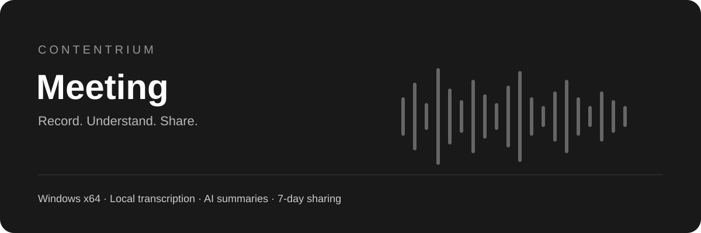
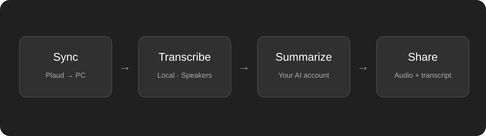

<p align="center"></p>

<h1 align="center">Contentrium Meeting</h1>
<p align="center"><strong>녹음을 모으고, 전사하고, 요약하고, 공유하세요.</strong><br>Plaud 클라우드 녹음을 PC에서 관리하는 개인 사용용 Windows 프로그램입니다.</p>
<p align="center"><a href="https://github.com/contentriumkorea/Contentrium-Meeting/releases/latest"></a>  <a href="LICENSE"></a></p>
<p align="center"><a href="#빠르게-시작하기">설치하기</a> · <a href="https://github.com/contentriumkorea/Contentrium-Meeting/releases/latest">다운로드</a> · <a href="#사용-모습">사용 모습</a> · <a href="GUIDE.md">상세 안내</a></p>

---

## 빠르게 시작하기

Windows x64 PC, Plaud 계정과 인터넷 연결이 필요합니다. 로컬 전사 모델은 설정에서 선택하여 별도로 내려받습니다.

[](https://github.com/contentriumkorea/Contentrium-Meeting/releases/latest/download/ContentriumMeetingSetup.exe)
[](https://github.com/contentriumkorea/Contentrium-Meeting/releases/latest/download/ContentriumMeetingPortable.zip)

1. 설치파일을 실행하거나 포터블 ZIP을 풀고 `PlaudDesktop.exe`를 실행합니다.
2. 설정에서 Plaud 연결과 저장 경로를 지정합니다.
3. 전사 모델 한 가지를 선택해 준비하고, 본인 AI 계정을 연결합니다.

[상세 설치 및 업데이트 안내 →](GUIDE.md)

## 기록을 정리하는 세 단계

| 01 · 모으기 | 02 · 이해하기 | 03 · 활용하기 |
| :--- | :--- | :--- |
| **Plaud 녹음 자동 동기화** | **로컬 전사와 화자 구분** | **요약·검색·공유** |
| 날짜별 저장, 폴더, 핀과 정렬 | 한국어·영어·일본어, GPU 우선 처리 | AI 요약, 녹음 기반 질문, 전사 클릭 재생 |

## 사용 모습

<p align="center"></p>

**PC에서 전사를 만들고, 완료된 기록을 요약과 공유로 연결합니다.**

위 이미지는 실제 녹음이나 계정 정보를 포함하지 않은 기능 흐름도입니다.

<details><summary><strong>추가 사용 예시</strong></summary>

- 새 녹음 다운로드 → 로컬 전사·화자 구분 → 요약 자동 생성
- 다시 전사 → 기존 자료 보존 → 새 전사를 기준으로 요약 갱신
- 전체 보관함에 질문하거나 선택한 녹음 안에서 대화
- 전사 구간을 눌러 해당 위치의 음성을 바로 재생
- A4 PDF, 화면용 PNG·PDF, 전사·음성 내보내기

</details>

## 설치·배포 안내

| 방식 | 사용 방법 |
| :--- | :--- |
| 설치형 | 본체를 포함한 설치 EXE입니다. 설치 후 계정 연결과 모델 준비를 진행합니다. |
| 포터블 | ZIP 압축 해제 후 실행합니다. 별도 설치기를 실행하지 않습니다. 설정·인증·모델은 사용자 PC의 앱 데이터에 보관되며 USB만으로 계정이 이동하지 않습니다. |
| 무결성 확인 | 릴리스의 `SHA256SUMS.txt`와 내려받은 파일의 SHA256을 비교할 수 있습니다. |

이 저장소는 설치파일과 안내용입니다. 앱 전체 소스, 개발 이력, 녹음 및 계정 데이터는 포함하지 않습니다.

## 이렇게 사용하세요

```text
Plaud 연결 → 저장 경로 선택 → 전사 모델 준비 → AI 연결
새 녹음 동기화 → 자동 전사 → 자동 요약 → 필요할 때 내보내기·공유
```

## 적용 범위와 제한

- 권장 조합은 Whisper Large v3 + Community-1입니다. Community-1은 Hugging Face 로그인과 모델 접근 권한이 필요합니다. 제공자가 요구하는 약관은 사용자가 직접 확인해야 합니다.
- 음성 인식·화자 구분·요약은 오류가 있을 수 있습니다. 과도한 문장 반복은 차단하며 중요한 내용은 원음과 대조하세요.
- 지원 NVIDIA GPU를 사용할 수 있으면 우선 사용하며, 환경에 따라 CPU로 처리할 수 있습니다.
- AI 요약에는 본인 API 키 또는 앱에서 지원하는 계정 연결이 필요합니다. API 사용료와 서비스 제한은 해당 계정에 적용됩니다.
- 공유는 선택한 음성·전사·요약을 contentrium.com에 업로드합니다. 최초 공유 시 별도 웹사이트 로그인이 필요할 수 있습니다. 링크를 가진 사람은 열람할 수 있고 생성 후 7일이 지나면 접근이 차단됩니다.
- 웹 공유에는 저장 용량과 업로드 개수 제한이 있습니다. 모델 파일과 사용자 인증정보는 배포 파일에 포함하지 않습니다.
- 설치파일은 현재 코드 서명이 없습니다. 새 파일에 대해 Windows가 평판 확인을 표시할 수 있습니다.

<details><summary><strong>상세 안내와 검증 범위</strong></summary>

자동 처리, 반복 전사 차단, 공유 업로드와 접근 제어를 검증했습니다. 실제 사이트에서 합성 음성의 링크 생성·재생·구간 이동·삭제 후 차단을 확인했습니다. 설치 패키지와 실행 중인 설치본의 파일 해시가 일치합니다. 모든 PC 환경의 최초 로그인·드라이버·모델 설치를 보증하지 않습니다.

</details>
<details><summary><strong>English overview</strong></summary>

Contentrium Meeting is a Windows x64 application for personal, noncommercial use. It synchronizes Plaud recordings, provides local multilingual transcription and speaker diarization, and connects your own AI account for summaries and recording-based chat. Optional web shares expire after seven days. Models and account credentials are not bundled. This repository distributes application binaries and documentation, not the application source tree.

</details>

---
<p align="center"><strong>CONTENTRIUM</strong><br><a href="LICENSE">사용 안내</a> · <a href="THIRD_PARTY_NOTICES.md">오픈소스 구성요소</a> · <a href="https://github.com/contentriumkorea/Contentrium-Meeting/releases/latest">Latest release</a></p>
<sub>Plaud, OpenAI, Hugging Face 및 기타 상표는 각 권리자의 소유입니다. 이 프로그램은 이들 서비스의 공식 제품이 아닙니다. 포함된 외부 구성요소에는 각 라이선스가 적용됩니다.</sub>
<p align="center"><a href="https://contentrium.com"></a></p>
